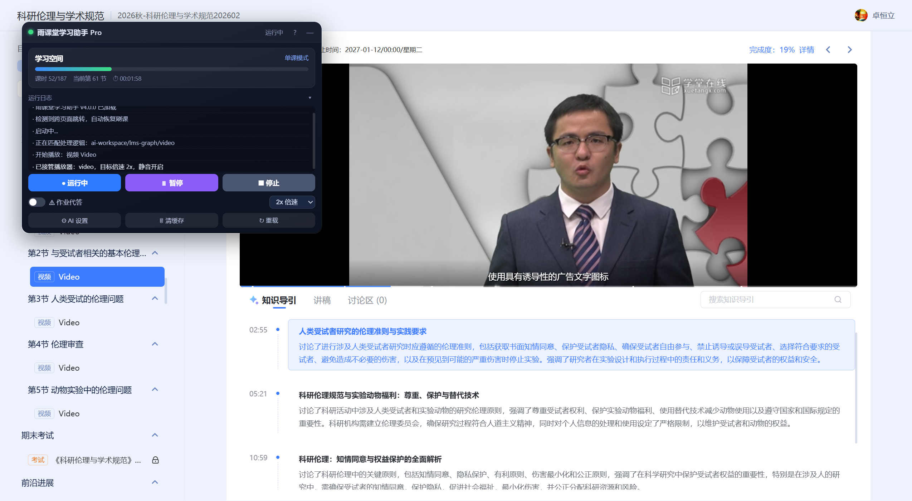

# 雨课堂学习助手 Pro（yuketang-helper）

长江雨课堂（`*.yuketang.cn`）研究生课程**全自动刷课**脚本：多课并行、倍速静音、进度 HUD、漏刷回补，开着就不管，刷完才停。

> 基于开源雨课堂脚本（GPL3）深度重构，保留相同许可证分发。

---

## ⚡ 快速开始（最省事用法）

```
双击 一键刷课.exe → 浏览器里登录雨课堂 → 选课面板勾选课程 → 放着不管
```

就这三步。脚本会自动：开课时页 → 逐集倍速静音播放 → 播完跳下一条 → 一门刷完接下一门 → **全部刷完自动停**。

你需要做的只有两件事：

- **腾讯滑块验证码**弹出来时手动滑一下（任何脚本都绕不过，这是铁律）
- 弹窗被浏览器拦截时，点一下选课面板里**闪动的按钮**放行（手动点击=浏览器放行）

> 控制台窗口别关——它是守护进程，页面崩了/刷新后自动补注入。关掉脚本就停摆。



---

## 核心功能

### 🎬 全自动刷课

- **整条链无人值守**：课程列表页弹选课面板 → 开目录页扫课时 → 逐集播放（视频/音频/图文全支持）→ 播完页内连播下一条 → 课程收尾**自动复查侧边栏漏刷课时回补** → 刷完接下一门直到清空
- **站点障碍自动清理**：诚信学习承诺书（3s 倒计时自动同意）、开播蒙层（自动点击站点手势起播）、各种提示弹窗（只认"好好学习/报告老师"等特定文案，绝不碰验证码）
- **真实播放上报**：服务端按播放位置记账，进度实打实入库（已实测验证：`completed:1`）

### 🚀 多标签并行刷多门课

- 选课面板**多选课程**，每门一个标签同时刷（实测 7 标签并行）
- **同门课永不双开**：跨标签抢占锁（90s TTL + 60s 心跳）；新标签克隆 `window.open` 的 storage 身份也不怕——BroadcastChannel 握手自动换发独立标签 id
- **幽灵锁自愈**：持锁标签死掉后，新标签认领失败会先 `whoClaims` 问一句"锁主还活着吗"，无人应答直接夺锁继续刷，不傻等 TTL

### 🎛 播放控制

- **倍速**：1x / 1.5x / 2x（默认）/ 2.5x / 3x / 拟人随机，下拉即时生效并记住选择
  - >3x 档位已移除——实测 HLS 分段下载喂不上 4x+，缓冲饿死原地踏步反而更慢
- **静音锁死**：音量属性劫持——站点回写音量全被吞掉，`muted` 被扳回瞬间压回去，SPA 重建 video 元素自动补针
- **暂停风暴熔断**：站点周期性发真实 pause（反作弊探测/housekeeping），脚本不再每秒硬抢——armed 门 + 500ms 恢复冷却 + 5s 内 6 次暂停熔断 8s，播放不再"一跳一跳"

### 📊 悬浮面板 HUD

- 课程名 / 第几门 / 进度条 / 当前第几节 / 已刷时长 / 状态灯，页内连播**实时**更新（不整页刷新也准）
- 可最小化成小球——**小球按住可拖动**，原地轻点才还原；深浅双主题切换自动记住
- 刷满变绿 + 烟花，日志可折叠；标题栏 ⏻ 总开关一键禁用/启用（**所有标签**生效）

### 🗳 选课面板

- 课程列表页自动弹出：全部课程 + 完成/进行中/未刷徽标，多选一键开标签
- **30s 无操作自动开全部未刷课**（倒计时中按任意键可取消）
- 完成徽标可点击切换 `已完成`/`未刷`（持久化在 `ykt_course_done`）
- 顶部「进入批量/退出批量」随时收手

### 📝 答题与考试（全部默认关，需手动开）

| 模式 | 干什么 | 风险边界 |
|---|---|---|
| **⚠ 作业代答** | 白名单课程（科研伦理/实验室安全）作业按内置题库勾选提交 | 缺题一律留空不提交——宁缺勿错；其它课程绝不碰 |
| **📋 答题助手** | 半自动：金色横幅逐题报答案，**你手动勾选提交** | 刷课推进暂停，纯辅助 |
| **📝 考试辅助** | 屏幕题目与内置题库（386 题）滑窗比对，**命中才显示答案** | 未命中显示"未匹配"，绝不瞎给；只读页面不点任何东西 |

> 三个开关互斥，均需确认弹窗。作业**提交不可撤销**，题库没有的一律不猜。

### 🛡 防检测设计

- 视频真实播放（不是刷接口），进度服务端自然记账
- 拟人随机倍速档、延时抖动、防切屏拦截、隐藏 `webdriver` 标记
- 暂停恢复让站点"赢"——风暴期不硬刚，行为更像真人挂课

---

## 其它使用方式

### B：油猴（macOS/Linux 用户）

1. Edge / Chrome 装 **Tampermonkey** 扩展
2. 新建脚本 → 粘贴 `yuketang-helper.user.js` 全文 → Ctrl+S 保存启用
3. 登录雨课堂打开课程列表页——面板出现、流程同上

> 油猴方式没有 watchdog 自动补注入，页面崩了手动刷新即可。

### C：交给 AI agent 代管

本脚本可用 CDP 无人值守运行。完整操作手册见 **[docs/AGENT_GUIDE.md](docs/AGENT_GUIDE.md)**——把该文件连同本仓库交给 agent 照做即可。

---

## 面板控件速查

| 控件 | 作用 |
|---|---|
| ▶ 开始 / ● 运行中 | 启动，或从暂停恢复 |
| ⏸ 暂停 | 停住推进，页面不刷新，点开始恢复（仅本标签） |
| ⏹ 停止 | 彻底停止并刷新 |
| ⏻ 总开关（标题栏） | **所有标签**禁用/启用脚本——想手动操作时按一下全部安静 |
| 📚（标题栏） | 课程列表页手动重开选课面板 |
| 🌙/☀️（标题栏） | 深/浅主题切换，自动记住 |
| ⚠ 作业代答 | 白名单课程作业按题库勾选提交（需确认，缺题留空不提交） |
| 📋 答题助手 | 半自动：逐题报答案，你手动提交 |
| 📝 考试 | 题库命中才显示答案，只读不影响刷课 |
| 倍速下拉 | 1x / 1.5x / 2x / 2.5x / 3x / 拟人随机，即时生效 |
| ⚙ AI 设置 | 可选 AI 答题/自动评论配置（默认全关） |
| 🗑 清缓存 | 清当前课程进度缓存 |
| ↻ 重载 | 刷新页面并自动恢复 |

## 注意事项

- **验证码手动滑**——腾讯滑块没有任何脚本能绕，多开时验证更频繁，求稳建议 ≤3 标签
- **弹窗拦截**：自动开多标签可能被浏览器拦——点闪动按钮放行即可，被拦课程保持选中不丢
- 讨论区不自动发帖、考试不自动答（除非你自己开了对应开关）
- 倍速再高也是真实播放上报，仍有被风控识别的理论可能——3x 封顶是稳与快的平衡点

## 目录结构

```
一键刷课.exe              # ★ 单文件免安装启动器（12.9MB，双击即用）
yuketang-helper.user.js   # 脚本本体（油猴/CDP 注入同源）
launcher.py               # 一体化启动器源码（exe 由它打包）
雨课堂题库.docx            # 题库文档（386 题，供人工核对）
README.md
docs/
  使用指南.md              # 详细图文说明
  AGENT_GUIDE.md          # 给 AI agent 的部署运维手册
  hud.png                 # 面板截图（已脱敏）
tools/
  make_inject.py          # userscript → CDP 可注入文件
  inject.js               # 生成的注入文件
  watchdog.py             # 刷新后自动补注入守护
  cdp.py                  # CDP 页面求值工具
```

## 许可证

GPL-3.0（继承自上游开源雨课堂脚本）。
